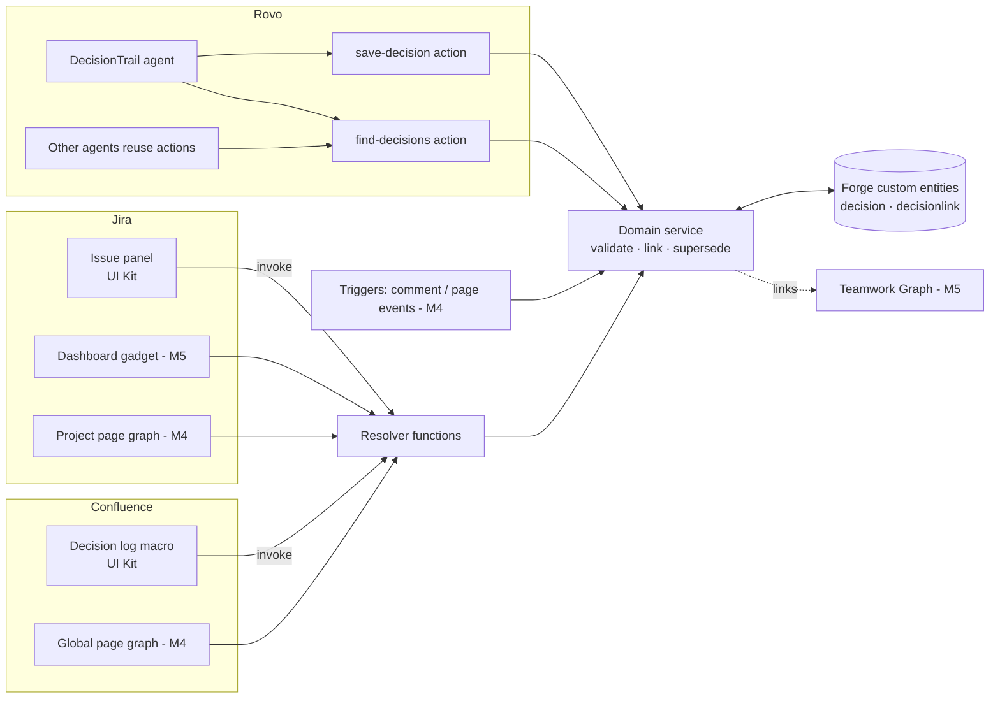

# DecisionTrail architecture

DecisionTrail makes team decisions first-class objects in Atlassian Cloud. A decision records what was chosen, why, which options were rejected, who decided and when, and which Jira issues and Confluence pages it affects. Rovo can capture decisions and answer "why is it like this?". Everything runs on Forge (Runs on Atlassian): there is no egress, no external service and no third-party API key.

## 1. Forge modules

| Module | Key | Status | Purpose |
|---|---|---|---|
| `jira:issuePanel` (UI Kit) | `decisiontrail-issue-panel` | **M1-2 built** | List the issue's decisions, add one, link an existing one, accept or reject proposals |
| `macro` (Confluence, UI Kit, with config) | `decisiontrail-decision-log` | **M1-2 built** | Live decision log table (filter by status) or "decisions linked to this page" |
| `rovo:agent` | `decisiontrail-agent` | **Stub built** | Decision Capture and "Why?" agent with conversation starters |
| `action` (Rovo actions, reusable by other agents) | `save-decision`, `find-decisions` | **Built** | Create a decision from flat inputs, linked to the issue or page in context; search decisions |
| `action` | `extract-decisions`, `explain-why` | M3 | Pull candidate decisions out of a comment thread; cited answer |
| `trigger` | `avi:jira:commented:issue`, `avi:confluence:updated:page` | M4 | Conflict and reversal guard: flag text that contradicts an accepted decision |
| `jira:projectPage` + `confluence:globalPage` (Custom UI) | `decisiontrail-graph` | M4 | Traceability graph: decision → issues → pages → superseding decisions |
| `jira:dashboardGadget` | `decisiontrail-health` | M5 | Decision health: no owner, stale proposals, reversal counts, ADR markdown export |
| `jira:issueContext` / `confluence:contentBylineItem` | | M5 | Badge with the decision count |
| `rovo:mcp` (stretch) | | M6 | Expose find/explain to IDE agents |

## 2. Data model (Forge custom entities, `@forge/kvs`)

```ts
Decision {
  id: string            // dec-<time>-<rand>
  title: string         // 3-200 chars
  rationale: string     // why, trade-offs (≤ 5000 chars)
  options: string[]     // options considered (≤ 20)
  status: 'proposed' | 'accepted' | 'superseded' | 'rejected'
  decidedBy: string     // Atlassian accountId (defaults to the caller)
  date: string          // YYYY-MM-DD
  links: { type: 'jira-issue' | 'confluence-page', id: string }[]
  supersedes?: string   // earlier decision id; that decision becomes superseded and gets supersededBy
  supersededBy?: string
  createdAt, updatedAt: string
}
```

| Entity | Key | Indexes | Notes |
|---|---|---|---|
| `decision` | decision id | `by-updated` (range updatedAt), `by-status` (partition status, range updatedAt) | Full document |
| `decisionlink` | `<decisionId>\|<type>:<id>` | `by-target` (range target) | One row per link, for "decisions on this issue/page" lookups. Kept in sync on every write |

Planned for M5: mirror the count to an issue property (`decisiontrail`) and a content property so JQL and CQL can find issues with decisions, e.g. `issue.property[decisiontrail].count > 0`.

## 3. Code layout and resolvers

```
src/domain/          pure logic: validation, CRUD, linking, supersede, sorting (no Forge imports)
src/storage/         ForgeRepo (custom entities) and MemoryRepo (tests)
src/resolvers/       handlers.ts (pure, testable) + index.ts (Forge Resolver wiring)
src/rovo/actions.ts  Rovo action handlers (saveDecision, findDecisions)
src/frontend/        UI Kit: issue panel, decision log macro, macro config
tests/               vitest unit tests against MemoryRepo
```

Resolver functions (all return `{ok:true,data}` or `{ok:false,error}`; validation errors are shown to the user, other errors are logged and hidden):

| Resolver | Payload | Behaviour |
|---|---|---|
| `listForContext` | none | Works out the issue key or page id from `context.extension` and returns its decisions |
| `listDecisions` | `{status?, query?}` | Filtered, sorted log (accepted first, newest first) |
| `getDecision` | `{id}` | |
| `createDecision` | `{decision, linkToContext?}` | Validates, links to the current issue or page, sets `decidedBy` to the caller, handles supersede |
| `updateDecision` | `{id, patch}` | e.g. accept or reject |
| `deleteDecision` | `{id}` | Removes the link rows too |
| `linkDecision` / `unlinkDecision` | `{id, link?}` | Link defaults to the current context |

## 4. Permissions and scopes

- `storage:app` for custom entities
- `read:jira-work` to read issue details and comments (M3 extraction)
- `read:confluence-content.summary` for page titles in the log
- M4-5 additions: `write:jira-work` (issue properties), `read:page:confluence` and `write:confluence-props`, and the trigger event scopes
- **No `external.fetch`**: the app is eligible for Runs on Atlassian, and all LLM work goes through Rovo
- Resolvers run as the app. M3 hardening: check that the calling user can view the issue or page (`asUser()` permission check) before returning decisions linked to it

## 5. Data flow



1. A user opens an issue. The panel calls `listForContext`, which reads the issue key from the extension context, queries `decisionlink.by-target` and loads the decisions.
2. "Add decision" calls `createDecision`, which validates the input, links it to the issue, sets the caller as `decidedBy`, and marks any superseded decision.
3. In Rovo chat, the agent turns the conversation into a structured decision and calls `save-decision` with the issue key from context. The same domain service is used, so the decision shows up in the panel and the Confluence log straight away.
4. "Why did we pick X?" makes the agent call `find-decisions` and answer citing decision ids and dates.

## 6. How it maps to the judging criteria (20% each)

| Criterion | How DecisionTrail scores |
|---|---|
| **Technological implementation** | Several Forge modules across two products and Rovo share one domain layer. Custom entities with secondary indexes, triggers, Custom UI graph. Unit-tested, typed, linted |
| **Design** | Native UI Kit (Atlassian design tokens, lozenges, DynamicTable), helpful empty states, one-click accept, macro config. A complete product, not a proof of concept |
| **Potential impact** | Every team loses decisions in threads and re-argues them. ADRs without the overhead, for software and business teams |
| **Innovation** | Decisions become linked, queryable graph objects. Rovo captures them from conversations and answers "why?". The conflict guard warns before a decision is silently reversed |
| **Presentation** | Demo storyline in PLAN.md §5: problem → capture → trace → ask why → guard, all inside 3 minutes, on seeded fictional "Acme" data |

## 7. Bonus prizes

- **Best Rovo agent:** `rovo:agent` plus reusable `action`s (save, find, extract, explain) that other agents can call
- **Teamwork Graph:** write decision ↔ issue/page/goal relations to the graph and read them to suggest links (API surface to confirm in M5)
- **MCP (stretch):** `rovo:mcp` exposing find and explain to IDE agents
- **Marketplace:** Runs on Atlassian with no egress is a trust signal. Submit the listing by 13 Dec for the review-ticket link

## 8. Testing and quality

- `npm run check` runs eslint, then `tsc --noEmit`, then vitest
- The domain and handlers have no Forge imports, so they're tested against `MemoryRepo`. ForgeRepo is a thin adapter verified on the dev site
- `forge lint` validates the manifest (it needs a Forge login)

## Cross-product data flow (Jira ↔ Confluence)

Forge hosted storage (KVS and custom entities) is **scoped per installation**. The Jira and Confluence installs are separate installations, even on the same site and with the same app id, so each has its own empty store. A decision saved from the Jira issue panel is therefore invisible to the Confluence macro's own store.

DecisionTrail uses **Jira as the shared system of record**. It uses only Atlassian APIs, so there is no external egress and it stays eligible for Runs on Atlassian:

- **Jira install (`MirroringRepo`, `src/jira/bridge.ts`):** every write still goes to the local custom-entity store. After the write, the app rewrites the `decisiontrail` issue entity property (`{count, decisions[]}`) on each affected issue via `api.asApp().requestJira` (scope `write:jira-work`). When the last decision is unlinked from an issue, the property is deleted. Opening an issue panel also refreshes that issue's property, which backfills decisions saved before the mirror existed.
- **Index:** the `jira:entityProperty` module `decisiontrail-issue-index` indexes `count` (`decisionCount` alias), so the property can be queried with JQL.
- **Confluence install (`FederatedRepo`):** reads merge the local Confluence store with `POST /rest/api/3/search/jql`, using `issue.property[decisiontrail].count > 0` and `properties=decisiontrail`. The search runs as **asUser**, so viewers only see decisions on issues they can see in Jira. The two sources are deduplicated by id, and the newest `updatedAt` wins. Writes stay local. If Jira can't be reached, the macro falls back to local data.
- **Resolver routing:** the resolver picks the repo per call from the extension context (`macro`/content → Confluence, otherwise Jira). Rovo actions pick it from `payload.context.confluence`.
- **Install requirement:** the app must be installed in both Jira and Confluence on the same site. After a scope change, run `forge install --upgrade` on both.

## M3: Rovo capture (F1) and "Why?" (F2)

- **Agents:** `DecisionTrail Capture` (`decisiontrail-agent`) and `DecisionTrail Why` (`decisiontrail-why-agent`).
- **`extract-decisions`** (`src/rovo/actions.ts` → `src/jira/comments.ts` → `src/domain/capture.ts`):
  - Reads the issue's summary, description and comments as the user (`requestJira`), or a page's footer comments (`requestConfluence` v2, scopes `read:page:confluence` and `read:comment:confluence`).
  - Flattens ADF and storage format to text.
  - Returns the thread plus heuristic candidates (title, chosen option, options, rationale, owner, date, confidence, source comment refs such as `jira:ACME-1#10004`).
  - It **saves nothing**. The agent proposes decisions, the user confirms, and the agent then calls `save-decision` with `sources`.
- **`explain-why`** (`src/domain/explain.ts`):
  - Ranks recorded decisions against the question by keyword overlap, favouring titles and accepted decisions.
  - Returns cited facts: decision id and date, rationale, options, linked issue/page URLs (base URL from `serverInfo`), source comments, and supersession in both directions.
  - The Why agent answers only from these facts. Any agent that lists the action can reuse it.
- **Storage and LLM:** decisions gain an optional `sources` attribute, declared in the entity schema. All LLM work runs in Rovo, with no egress.
- **Demo data:** `scripts/seed-acme-comments.ts` posts the fictional Acme Kafka-vs-RabbitMQ thread (`scripts/demo-thread.ts`) to ACME-1. It is idempotent.

## M4: Conflict guard (F6) and traceability graph (F5)

**Conflict guard.** The `trigger` module `decisiontrail-conflict-guard` listens for `avi:jira:commented:issue` and runs `conflict-guard-fn` (`resolvers/index.conflictGuard`). The flow:

1. `runGuard` reads the comment as the app. It skips app-authored comments and anything carrying `GUARD_MARKER`, which prevents loops.
2. It runs `detectConflicts` against the issue's accepted decisions. That function flags phrases that move toward a rejected option ("switch to / use / go with X") or away from the chosen one ("drop / replace / move away from X").
3. New flags are stored in KVS under `conflicts:<issueKey>`. They're deduped on comment and decision, and only the last 50 are kept.
4. The guard posts one warning-panel comment that @mentions the decision owner.

The issue panel shows each flag with two actions:
- **Record superseding decision** creates an accepted decision with `supersedes` set and the comment in `sources`. The old decision becomes superseded.
- **Dismiss** removes the flag.

**Trace graph.** `buildGraph` turns decisions into nodes (decision, issue, page) and edges (affects, documented-in, supersedes). It also produces supersession lineages and stats. The graph shows on two pages:
- `jira:projectPage`, scoped to the current project. A project filter keeps whole supersession chains.
- `confluence:globalPage` (route `decision-trace`), which shows all decisions.

Both pages are rendered with UI Kit, so no graph library is needed. Labels come from asUser JQL (`key in (...)`) and the Confluence v2 pages API. If label lookup fails, the page falls back to IDs. M4 adds no new scopes and no egress.

## M5: Work links (F7) and decision health (F8)

**Teamwork Graph: why remote links rather than the TWG API.** The Teamwork Graph *API* (Cypher or GraphQL reads, `read:graph:*` scopes) has been in Preview since 15 Oct 2026. Three constraints rule it out for now:
- Installing an app with TWG scopes needs an organization admin.
- The API may change on one month's notice.
- During EAP, apps that use it couldn't be deployed to production or distributed. That would break the judges' installation link.

Teamwork Graph *connectors* (`graph:connector`, `setObjects` / `setRelationships`) are meant for ingesting third-party data, and they're Jira-only.

So F7 writes the decision ↔ work relationship through the supported Jira link API, which Teamwork Graph already indexes. `MirroringRepo.syncIssues` calls `JiraHttp.syncRemoteLinks`. For each issue it upserts one remote link per Confluence page that documents a decision on that issue:
- relationship: "Decision record"
- deterministic `globalId`: `decisiontrail:page:<id>`, which makes repeated syncs idempotent
- stale app-owned links are deleted; links made by other apps or users are never touched

Link sync is best-effort, so a failure is logged and never blocks a save. This uses `write:jira-work`, so no new scopes were added. Once the TWG API reaches GA, the `buildGraph` input can be enriched with `read:graph:issue:jira` or `read:graph:page:confluence` curated queries, adding goals and teams. Neither the domain layer nor the UI would need to change.

**Health gadget.** `jira:dashboardGadget` `decisiontrail-health-gadget` calls `decisionHealth`, which wraps `healthReport`:
- status counts
- no owner
- stale proposals, meaning still proposed after 14 days
- unlinked decisions
- reversals and the most-reversed chains

`exportAdr` returns `toAdrMarkdown`: Nygard-style ADRs numbered oldest first, with a superseded decision always numbered before its replacement. Each ADR has status and supersession cross-references, absolute issue and page links (base URL from `serverInfo`), options, rationale and source citations.

**Onboarding.** Empty states explain the workflow on every surface. The Jira panel's **Load Acme demo decisions** button (`seedDemo`) creates the fictional Acme chain on the current issue, matched by title so repeat clicks don't duplicate it. `scripts/seed-judge.ts` creates the Jira project, issue, comment thread and Confluence page on a judge's site over REST using their own API token.

**Storage note.** Custom entities reject empty attribute values, so `ForgeRepo.put` drops blank or undefined fields and `withDefaults` restores them on read.

## Shared installation (app compatibility)
`app.compatibility` declares Jira required and Confluence optional, so one installation (and one store) serves both products and Rovo registers each agent once. Confluence handlers and Rovo actions now read the shared store directly. The issue-property mirror is kept because it backs JQL search and lets `restoreFromMirror` re-import decisions into an empty store after a reinstall. This runs once per installation on the first resolver call and adds demo source citations. `FederatedRepo` is used only when `DT_SPLIT_INSTALLS=1` (legacy per-product installs).
